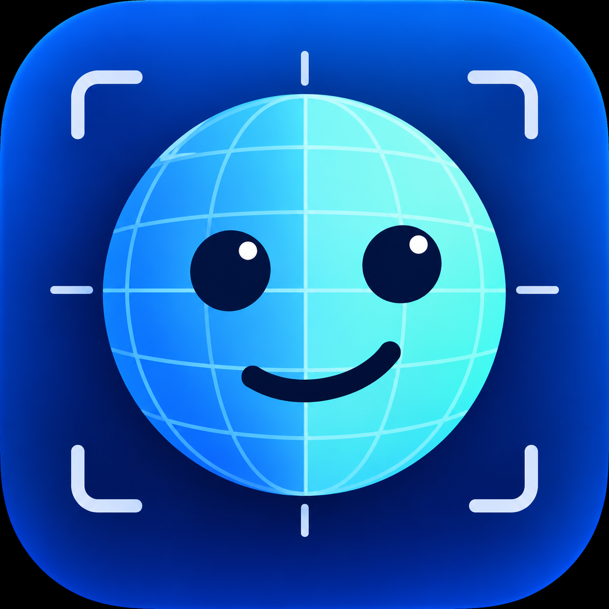

<p align="center"></p>

# Fylgja · Universal Camera Head Tracking

[简体中文](README.md)

Turns any **webcam** into a 6DoF head tracker. Estimates head pose in real time and outputs it via the
**OpenTrack "UDP over network" protocol**, so games and sims that support head tracking —
**War Thunder, DCS, IL-2**, and more — work through [OpenTrack](https://github.com/opentrack/opentrack) as a bridge.

Dual inference engines: **NPU (Intel AI Boost)** offloads tracking from the CPU so games keep their cores;
**CPU (MediaPipe)** is the zero-dependency fallback. MIT licensed · fully local · privacy-first (see [Privacy](#privacy)).

  

---

## Features

- **6DoF output**: yaw / pitch / roll + translation (TX/TY/TZ) over standard OpenTrack UDP
- **Dual engines**: `N` = OpenVINO + Intel NPU (CPU offload, 1.6–2.7× throughput measured); `C` = MediaPipe CPU (zero extra drivers)
- **Measured accuracy** (275HX): ≤ 0.5°/axis RMS vs the official MediaPipe pipeline; stationary jitter < 0.05°
- **Modern UI**: Windows 11 Fluent design, system-following dark mode; live preview with toggleable axes / landmark overlays
- **Tray background mode**: closing the window minimizes to tray while tracking keeps running
- **One Euro filtering**: stable when still, responsive when moving, tunable live; one-click recenter; per-axis invert
- **Privacy first**: frames are processed in memory only — never written to disk, never sent anywhere

## Requirements

| Item | Requirement |
|---|---|
| OS | Windows 11 (x64) |
| Camera | Any RGB webcam (640×480 @30 FPS or better recommended) |
| CPU | Desktop/laptop processor from 2019 or later |
| NPU (optional) | Intel AI Boost (Core Ultra series), driver **32.0.100.3717+** — CPU engine works without it |

## Install & Quick Start

1. Download the ZIP from [Releases](../../releases) and verify `SHA256SUMS`:
   ```powershell
   Get-FileHash .\Fylgja-x.y.z-win64.zip -Algorithm SHA256
   ```
2. Right-click the ZIP → Properties → check **Unblock** → Apply, *then* extract (order matters).
3. If SmartScreen appears: More info → **Run anyway** (normal for unsigned builds — not malware).
4. Double-click **`Fylgja.pyw`** (no console window). Recommended: right-click → Send to → Desktop shortcut — the Fylgja icon is used.
5. Pick engine & camera, click **Start**. The preview showing your face with green landmarks means it works.

> For the NPU engine, install the [Intel NPU driver](https://www.intel.com/content/www/us/en/download-center/home.html)
> (32.0.100.3717 or newer) first, restart the app, and select `N (NPU)`.

## Usage

| Control | Description |
|---|---|
| ▶ Start / ■ Stop | Start/stop the tracking pipeline |
| Engine | `auto` / `N (NPU)` / `C (CPU)` — self-check runs on selection |
| Camera | Enumerated devices (friendly names); your pick is remembered |
| Output | Address & port OpenTrack listens on (default `127.0.0.1:4242`) |
| Filter | `min_cutoff` (lower = steadier), `beta` (higher = snappier), live |
| Invert | Flip individual axes (if direction feels wrong) |
| Axes / Points | Preview overlays (axes always drawn from the **actual sent values**) |
| Recenter (F12) | Zero the current pose |
| 中 / EN | Switch UI language |

**Tray**: closing the window minimizes to tray and tracking continues; tray menu offers show / start / stop / quit.

## Spatial Audio (bonus feature)

Adjusts left/right channel volume in real time by head orientation — a **fixed sound field**
(turn left → left ear softens). When face tracking is lost, volume smoothly returns to balance
within ~0.3 s. **Headphones recommended.**

**Three steps:**

1. Install [VB-CABLE](https://vb-audio.com/Cable/) (free virtual audio cable; not bundled)
2. Switch system audio output to `CABLE Input (VB-Audio Virtual Cable)`
3. In Fylgja's "Spatial Audio" panel: pick your headphones → check "Enable"

Parameters: `Max attenuation` (default 12 dB, up to 60 dB — one ear can go near-silent),
`Deadzone` (default 5°); L/R gain shown live.

**System volume works directly**: adjust the CABLE device volume (what the Windows volume keys
control) to change what you hear.

## Getting it into games (War Thunder etc.)

This app produces pose data; games are reached through **OpenTrack** (the open-source middle layer):

```
Camera → Fylgja → UDP 127.0.0.1:4242 → OpenTrack → FreeTrack/TrackIR protocol → Game
```

**War Thunder setup:**

1. Install [OpenTrack](https://github.com/opentrack/opentrack/releases) (latest Windows build).
2. In OpenTrack:
   - **Input**: `UDP over network`, port `4242`
   - **Output**: `Freetrack 2.0 Enhanced` (War Thunder natively supports TrackIR/FreeTrack)
   - Click **Start** — the numbers should move with your head (start Fylgja first).
3. Launch War Thunder: Settings → Controls → **View / head tracking**, enable the head-tracking device (TrackIR),
   and bind yaw/pitch/roll to the free-look camera as desired.
4. Run the game in **windowed / borderless** mode (exclusive fullscreen can block TrackIR).
5. Tune sensitivity, deadzone and curves in OpenTrack's Mapping panel; flip individual axes in Fylgja if directions feel wrong.

Other titles work the same way: **DCS / IL-2 / X-Plane / Euro Truck** — anything supporting TrackIR/FreeTrack with
Output set to `Freetrack 2.0 Enhanced`. Sims with direct UDP input can point straight at their port;
Microsoft Flight Simulator is covered by OpenTrack's dedicated output.

## Output protocol

Native OpenTrack "UDP over network" format: **48 bytes = 6 little-endian doubles**:

| Bytes | 0–7 | 8–15 | 16–23 | 24–31 | 32–39 | 40–47 |
|---|---|---|---|---|---|---|
| Field | TX | TY | TZ | yaw | pitch | roll |

Angles in degrees; translation in centimeters (approximate — monocular depth has inherent error).
Default target: `127.0.0.1:4242`.

## Configuration & data locations

| Item | Location |
|---|---|
| Scalar settings | Registry `HKCU\Software\Fylgja\Fylgja` |
| Structured config (filter/calibration/invert) | `%LOCALAPPDATA%\Fylgja\config.json` |
| Logs (5 MB ×3 rotation) | `%LOCALAPPDATA%\Fylgja\logs\` |
| Model file | `models\face_landmarker.task` next to the app (SHA256-verified) |

## Architecture

```
Camera → capture thread (depth-1 mailbox) → PoseEngine ─┬─ Engine N: BlazeFace(CPU) → ROI → landmarks(NPU) → weighted Procrustes
                                                        └─ Engine C: MediaPipe FaceLandmarker(CPU)
      → ZXY Euler → One Euro filter → calibration → recenter → axis invert → OpenTrack UDP
```

Both engines share the same post-processing and output stage, so switching engines never changes downstream behavior.

## Accuracy & performance (measured on Intel Core Ultra 9 275HX)

| Metric | Result |
|---|---|
| Rotation diff vs MediaPipe pipeline | yaw 0.49° / pitch 0.45° / roll 0.40° (RMS, < 0.5° per axis) |
| Stationary jitter (frame-diff std) | < 0.05° |
| Engine N throughput | 78–160 FPS (MediaPipe engine C: 47–59 FPS) |
| Inference latency p95 | ≤ 8.8 ms |
| CPU usage reduction (N vs C) | ~20–30% in typical scenarios |

## Privacy

- Camera frames are processed **in memory only** — never saved, screenshotted, recorded, or transmitted.
- The only network activity: sending UDP pose packets to *your* configured sink address.
- Engine N (OpenVINO): **no outbound traffic at all** besides the UDP stream.
- Engine C (MediaPipe Tasks): per Google's terms, sends **anonymous usage metrics (no images, no face data)**.
  If that concerns you, use engine N — or see the [MediaPipe terms](https://developers.google.com/edge/mediapipe/legal/tos).
- No telemetry of our own, no update checks, no accounts.

## Development

```powershell
# regression tests (54)
$env:PYTHONPATH = "src"; .\.venv\Scripts\python.exe -m unittest discover -s tests

# CLI pipeline
.\.venv\Scripts\python.exe -m fylgja.app --engine C --model models\face_landmarker.task
```

- Core modules in `src/fylgja/`, tests in `tests/`, tooling in `scripts/` (NPU gate checks, long-run harness, pose annotation).
- Roadmap: autostart manager → calibration wizard → packaging & signing → face registration (multi-face lock-on).

## License

MIT — see [LICENSE](LICENSE). Third-party components (MediaPipe / OpenVINO / OpenCV, etc.) ship their
licenses and notices in the release's `licenses/` folder. The One Euro Filter algorithm is by Casiez et al.
(CHI 2012) — with thanks.
