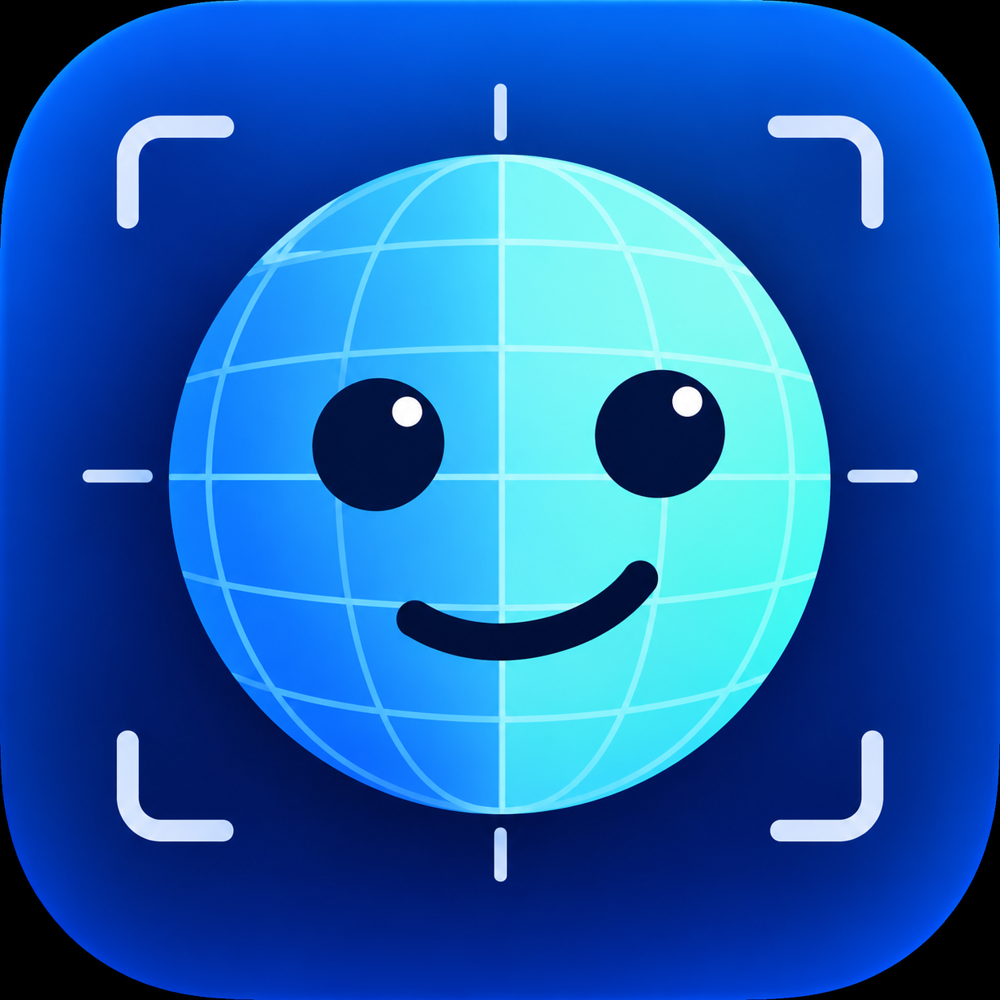

<p align="center"></p>

# Fylgja · 通用摄像头头部追踪

[English](README.en.md)

以**普通摄像头**为唯一输入，实时估计头部姿态，按 **OpenTrack「UDP over network」协议**输出 6 自由度数据，
经 [OpenTrack](https://github.com/opentrack/opentrack) 桥接即可驱动**战争雷霆、DCS、IL-2** 等支持头部追踪的游戏与模拟器。

双推理引擎：**NPU（Intel AI Boost）** 把追踪负载从 CPU 卸载，游戏满载时不抢核；**CPU（MediaPipe）** 兜底零依赖。
MIT 开源 · 本地运行 · 无遥测（详见[隐私](#隐私)）。

  

---

## 特性

- **6DoF 姿态输出**：偏航 / 俯仰 / 滚转 + 平移（TX/TY/TZ），OpenTrack UDP 标准协议
- **双引擎**：`N` = OpenVINO + Intel NPU（CPU 卸载，实测吞吐 1.6–2.7×）；`C` = MediaPipe CPU（零额外驱动兜底）
- **实测精度**（275HX）：与 MediaPipe 官方管线旋转差 ≤ 0.5°/轴，静止抖动 < 0.05°
- **现代界面**：Win11 Fluent 风格，深色模式跟随系统；实时预览 + 可开关的坐标轴 / 关键点叠加
- **托盘后台**：关窗最小化到托盘继续追踪，游戏时保持运行
- **One Euro 滤波**：静止稳定、动态跟手，参数实时可调；一键回中、逐轴反转
- **隐私优先**：画面仅内存处理，不落盘不外传

## 环境要求

| 项目 | 要求 |
|---|---|
| 系统 | Windows 11（x64） |
| 摄像头 | 任意 RGB 摄像头（推荐 640×480 @30 FPS 以上） |
| CPU | 2019 年后桌面/笔记本处理器 |
| NPU（可选） | Intel AI Boost（Core Ultra 系列），驱动 **32.0.100.3717+**；不装也可用 CPU 引擎 |

## 安装与快速开始

1. 从 [Releases](../../releases) 下载 ZIP，核对 `SHA256SUMS`：
   ```powershell
   Get-FileHash .\Fylgja-x.y.z-win64.zip -Algorithm SHA256
   ```
2. 右键 ZIP → 属性 → 勾选**解除锁定** → 应用，然后解压（顺序重要，避免逐文件解锁）。
3. 若 SmartScreen 提示：更多信息 → **仍然运行**（未签名分发的正常提示，非病毒）。
4. 双击 **`Fylgja.pyw`** 启动（无命令行窗口）。建议右键 → 发送到 → 桌面快捷方式，图标即为 Fylgja 标志。
5. 选择引擎与摄像头 → 点击**开始**。预览出现画面与绿色关键点即为正常。

> 需要 NPU 引擎时，先安装 [Intel NPU 驱动](https://www.intel.com/content/www/us/en/download-center/home.html) 32.0.100.3711 以上版本，重启应用后选择 `N（NPU）`。

## 使用

| 控件 | 说明 |
|---|---|
| ▶ 开始 / ■ 停止 | 启动 / 停止追踪管线 |
| 引擎 | `auto` / `N（NPU）` / `C（CPU）`，选择后自动自检 |
| 摄像头 | 枚举本机设备（友好名），选择后记住 |
| 输出 | OpenTrack 监听的地址与端口（默认 `127.0.0.1:4242`） |
| 滤波 | `min_cutoff`（越小越稳）、`beta`（越大越跟手），实时生效 |
| 反转 | 逐轴翻转方向（方向反了时用） |
| 坐标轴 / 关键点 | 预览叠加开关（坐标轴始终按**实际发送值**绘制） |
| 回中 (F12) | 以当前姿态归零 |
| 中 / EN | 界面语言切换 |

**托盘**：关闭窗口 = 最小化到托盘继续追踪；托盘菜单可显示 / 开始 / 停止 / 退出。

## 空间音频（附属功能）

按头部朝向实时调整左右声道音量，营造"声音留在原地"的听感（**固定声场**：头向左转 → 左耳变轻）。
面部追踪丢失时，音量会在约 0.3 秒内平滑回到左右平衡。**建议使用耳机。**

**设置三步**：

1. 安装 [VB-CABLE](https://vb-audio.com/Cable/)（免费虚拟声卡，不随本软件分发）
2. 系统声音输出切换到 `CABLE Input (VB-Audio Virtual Cable)`
3. Fylgja 右侧「空间音频」区：选择你的耳机 → 勾选「启用」

参数：`最大衰减`（默认 12 dB）、`死区`（默认 5°，转头多少度以内不生效）；L/R 增益实时显示。

## 对接游戏（战争雷霆等）

本软件只负责「摄像头 → 姿态数据」，游戏对接由 **OpenTrack**（开源中间层）桥接：

```
摄像头 → Fylgja → UDP 127.0.0.1:4242 → OpenTrack → FreeTrack/TrackIR 协议 → 游戏
```

**战争雷霆（War Thunder）设置步骤**：

1. 安装 [OpenTrack](https://github.com/opentrack/opentrack/releases)（选最新 Windows 版）。
2. 打开 OpenTrack：
   - **Input** 选 `UDP over network`，端口 `4242`
   - **Output** 选 `Freetrack 2.0 Enhanced`（战争雷霆原生支持 TrackIR/FreeTrack）
   - 点 **Start**，此时应能看到数字随头部运动（先启动 Fylgja 并点开始）。
3. 启动战争雷霆：设置 → 控制 → **视角/头部追踪**，启用头部追踪设备（TrackIR），按需绑定偏航/俯仰/滚转到自由视角。
4. 游戏用**窗口化 / 无边框**运行（独占全屏可能屏蔽 TrackIR）。
5. 灵敏度、死区、曲线都在 OpenTrack 的 Mapping 里调；方向不对就在 Fylgja 里用「反转」逐轴翻转。

其他游戏同理：**DCS / IL-2 / X-Plane / 欧卡** 等凡支持 TrackIR/FreeTrack 的，Output 都选 `Freetrack 2.0 Enhanced`；
支持 UDP 直连的模拟器也可以直接指向其端口。部分游戏（如微软模拟飞行）可通过 OpenTrack 的 `Microsoft Flight Simulator` 输出。

## 输出协议

OpenTrack「UDP over network」原生协议：**48 字节 = 6 个 little-endian double**，字段顺序：

| 字节 | 0–7 | 8–15 | 16–23 | 24–31 | 32–39 | 40–47 |
|---|---|---|---|---|---|---|
| 字段 | TX | TY | TZ | yaw | pitch | roll |

角度单位为度，平移为厘米（近似值，单目平移含固有误差）。默认发送至 `127.0.0.1:4242`。

## 配置与数据位置

| 项 | 位置 |
|---|---|
| 标量配置 | 注册表 `HKCU\Software\Fylgja\Fylgja` |
| 结构化配置（滤波/标定/反转） | `%LOCALAPPDATA%\Fylgja\config.json` |
| 日志（5 MB ×3 轮转） | `%LOCALAPPDATA%\Fylgja\logs\` |
| 模型文件 | 程序目录 `models\face_landmarker.task`（SHA256 校验） |

## 架构

```
摄像头 → 采集线程（深度1信箱）→ PoseEngine ─┬─ 引擎 N：BlazeFace(CPU) → ROI → 关键点(NPU) → 加权 Procrustes
                                            └─ 引擎 C：MediaPipe FaceLandmarker(CPU)
        → ZXY 欧拉分解 → One Euro 滤波 → 标定 → 回中 → 轴反转 → OpenTrack UDP
```

两引擎共用同一后处理与输出，保证切换引擎不改变下游行为。设计细节见内部工程方案书。

## 精度与性能（Intel Core Ultra 9 275HX 实测）

| 指标 | 结果 |
|---|---|
| 与 MediaPipe 管线旋转差 | yaw 0.49° / pitch 0.45° / roll 0.40°（RMS，每轴 < 0.5°） |
| 静止抖动（帧间差分 std） | < 0.05° |
| 引擎 N 吞吐 | 78–160 FPS（MediaPipe 引擎 C：47–59 FPS） |
| 推理延迟 p95 | ≤ 8.8 ms |
| CPU 占用降幅（N vs C） | 典型场景约 20–30% |

## 隐私

- 摄像头画面**仅在内存中处理**，不落盘、不截图、不录制、不外传。
- 唯一网络行为：向你配置的 PoseSink 地址发送 UDP 姿态包。
- 引擎 N（OpenVINO）：除 UDP 外**无任何外发**。
- 引擎 C（MediaPipe Tasks）：按 Google 条款会发送**匿名用量指标（不含画面与人脸数据）**，
  介意者请使用引擎 N，或参见 [MediaPipe 隐私说明](https://developers.google.com/edge/mediapipe/legal/tos)。
- 无遥测、无更新检查、无账号。

## 开发

```powershell
# 回归测试（54 项）
$env:PYTHONPATH = "src"; .\.venv\Scripts\python.exe -m unittest discover -s tests

# 命令行管线
.\.venv\Scripts\python.exe -m fylgja.app --engine C --model models\face_landmarker.task
```

- 核心模块在 `src/fylgja/`，测试在 `tests/`，脚本在 `scripts/`（含 NPU 门槛验证、长跑台架、姿态标注）。
- 路线图：启动项管理 → 标定向导 → 打包与签名 → 面部注册（多脸防误跟）。

## 许可证

MIT，详见 [LICENSE](LICENSE)。第三方组件（MediaPipe / OpenVINO / OpenCV 等）的许可证与署名随发布包 `licenses/` 提供；
One Euro Filter 算法出自 Casiez 等（CHI 2012），特此致谢。
